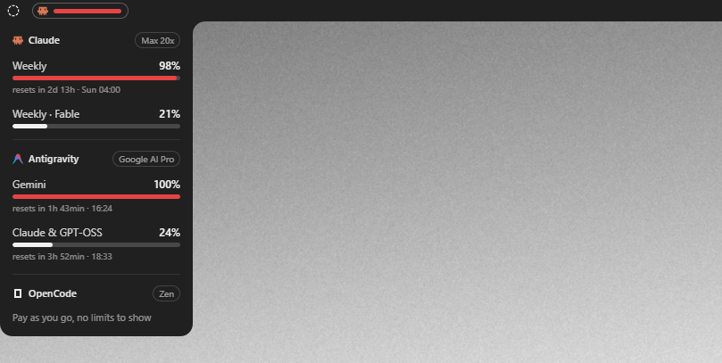

# AI Usage

Your Claude, Gemini, and OpenCode Go limits on Ridge: one pill with a configurable icon and a live usage bar that turns amber and red as you near a limit.

Hover or click the pill for the breakdown of every provider you have turned on in Settings, with each window's percentage used and reset countdown.

## Providers

Turn each provider on or off in **Settings** > **AI Usage**:

- **Claude**: reads your local Claude Code login (`~/.claude/.credentials.json`) and checks Anthropic's usage endpoint.
- **Gemini**: reads your local Gemini CLI OAuth login (`~/.gemini/oauth_creds.json`) and checks your model quota buckets.
- **OpenCode Go**: reads your API key from `~/.local/share/opencode/auth.json`, `OPENCODE_GO_API_KEY` / `OPENCODE_API_KEY`, or an API key saved in the plugin's Settings page.

## Topbar pill

Customize the pill in **Settings** > **AI Usage**:

- **Topbar icon**: Clawd, Claude, Gemini, OpenCode, Active provider, or None.
- **Topbar bar**: show the highest usage across enabled providers, or pin the bar to one provider.
